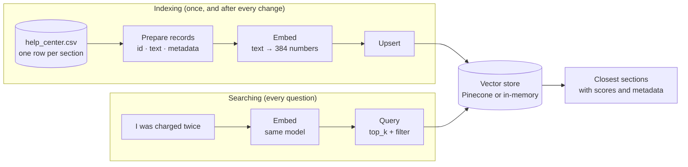

# Help Center Search

[](https://docs.pinecone.io)
[](https://sbert.net)
[](https://www.python.org)

[](LICENSE)

Semantic search over a help center, built with sentence-transformers and the Pinecone vector database. Ask "I was charged twice" and it finds the section about duplicate charges, even though the words don't match.

- [`helpdesk_search/`](helpdesk_search) has the data preparation, embeddings, vector stores and search.
- [`examples/`](examples) has one short, runnable script per vector database concept.
- `python -m helpdesk_search "your question"` searches from the terminal.

## How it works



Each record in the store has three parts:

| Part | Example | Used for |
|---|---|---|
| `id` | `2-1` (article 2, section 1) | Updating, deleting, fetching, querying by id |
| `values` | 384 numbers from the embedding model | Finding records with a similar meaning |
| `metadata` | `{"category": "billing", "read_minutes": 3, ...}` | Showing results, and filtering before ranking |

## Try it

```bash
python -m helpdesk_search "I was charged twice"
```

```
0.678  [ 2-1]  Refunds and duplicate charges > Charged twice
                If you see two identical charges, one is usually a pending authorization that drops off on its own. ...
0.362  [ 1-3]  Understanding your bill > Pending charges
                A pending charge is a temporary authorization hold from your bank. ...
0.359  [ 1-1]  Understanding your bill > When you are charged
                Subscriptions renew on the same day each month. ...
```

Options: `--top-k 5`, `--category billing`, `--articles` to search whole articles, `--model bert` to use the BERT model.

## What the embeddings look like

The 10 articles, each embedded from its full text, projected from 384 dimensions down to 2 with PCA. Articles about similar things land close together, without the model ever seeing the categories.


The axis names are an interpretation: PCA axes have no labels, and these two keep only about a third of the variation.

## Articles or sections?

The same question against both indexes, from [`examples/index_sections.py`](examples/index_sections.py):

| Question | Best article | Best section |
|---|---|---|
| How long does the reset link last? | Privacy and your data ❌ | Signing in > Forgot your password ✅ |
| What happens to my projects if someone leaves? | Inviting your team | Inviting your team > Removing someone |

An article vector blends everything the article covers, so one detail gets diluted. Section vectors are specific, so detail questions land on the right paragraph. Article vectors are still useful for "related articles" ([`examples/recommendations.py`](examples/recommendations.py)).

Each section's embedded text starts with its article title, so a short section like "Lost your phone" still carries the context of "Signing in".

## Setup

```bash
python3 -m venv .venv
source .venv/bin/activate
pip install -e ".[dev]"
```

```bash
pytest
```

The first run downloads the embedding models from Hugging Face (about 90 MB for MiniLM and 265 MB for the BERT model) and caches them. After that, everything runs offline.

## Using Pinecone

By default, vectors are kept in memory by [`InMemoryStore`](helpdesk_search/store.py), so no account is needed. It supports the same operations, scores and metadata filters as Pinecone, so every example runs either way.

To use Pinecone, copy `.env.example` to `.env`, then set:

```
VECTOR_STORE=pinecone
PINECONE_API_KEY=...
```

The first search creates a serverless index per model (`helpdesk-search-minilm`, `helpdesk-search-bert`), with one namespace per level (`sections`, `articles`), and fills it. Free Starter accounts allow 5 indexes.

```bash
RUN_PINECONE_TESTS=1 pytest -m pinecone
```

runs the tests that talk to Pinecone. They write to a temporary namespace and clean up after themselves.

## Examples

Listed from the basics to applications.

| Script | Shows |
|---|---|
| [`vector_space.py`](examples/vector_space.py) | Cosine similarity, dot product and Euclidean distance, in 2-D and in 384-D |
| [`embeddings.py`](examples/embeddings.py) | Embedding sentences and comparing them with a similarity matrix |
| [`pinecone_basics.py`](examples/pinecone_basics.py) | The raw Pinecone client: create an index, upsert, query, filter, fetch, delete |
| [`index_articles.py`](examples/index_articles.py) | Loading the CSV, building records, embedding and upserting, searching |
| [`update_and_delete.py`](examples/update_and_delete.py) | Updating metadata, re-embedding changed text, deleting |
| [`index_sections.py`](examples/index_sections.py) | Indexing sections with combined ids and text, compared with articles |
| [`minilm_vs_bert.py`](examples/minilm_vs_bert.py) | Two embedding models: dimensions, speed, results |
| [`metadata_filters.py`](examples/metadata_filters.py) | Filters: `$eq`, `$in`, `$lte`, `$and` |
| [`recommendations.py`](examples/recommendations.py) | "Related articles" by querying with a stored vector's id |

## MiniLM or BERT?

From [`examples/minilm_vs_bert.py`](examples/minilm_vs_bert.py):

| | MiniLM | BERT (DistilBERT) |
|---|---|---|
| Model | `all-MiniLM-L6-v2` | `multi-qa-distilbert-cos-v1` |
| Dimensions | 384 | 768 |
| Download | ~90 MB | ~265 MB |
| Speed | ~2× faster | |
| Results on this data | Right article for all 4 example questions | Right article for 3 of 4 |

A bigger model isn't automatically better: it costs more memory, storage and time per query, and on short, plain support text MiniLM does as well. Vectors from different models can't be mixed, so changing models means re-indexing everything into a new index with the new dimension.

## Where vector databases are used

- **Semantic search** over documents, tickets or products, as in this repo.
- **Recommendations:** "more like this" by querying with an item's own vector, as in [`recommendations.py`](examples/recommendations.py).
- **Image search:** models like CLIP embed images and text into the same space, so a text query finds matching photos.
- **Biomedical research:** embeddings of papers, proteins or molecules help find similar compounds and related studies.
- **Retrieval for chat agents:** fetch the relevant sections and give them to an LLM as context before it answers.

## Cheat sheet

| I want to | Use |
|---|---|
| Embed text | `SentenceTransformer(name).encode(texts, normalize_embeddings=True)` |
| Create an index | `pc.create_index(name, dimension=384, metric="cosine", spec=ServerlessSpec(cloud="aws", region="us-east-1"))` |
| Open it | `index = pc.Index(name)` |
| Add or replace vectors | `index.upsert(vectors=[{"id": ..., "values": [...], "metadata": {...}}], namespace=...)` |
| Search | `index.query(vector=[...], top_k=3, include_metadata=True, filter={...})` |
| "More like this" | `index.query(id="2", top_k=3)` |
| Change metadata only | `index.update(id="2", set_metadata={...})` |
| Change the text | Re-embed it, then `index.update(id="2", values=[...])` or upsert again |
| Delete | `index.delete(ids=[...])`, or `delete_all=True` for a namespace |
| Count vectors | `index.describe_index_stats()` |
| Filter | `{"category": "billing"}`, `{"read_minutes": {"$lte": 3}}`, `{"$or": [...]}` |

## Notes

- Pinecone is eventually consistent: a write can take a few seconds to show up in queries and stats. The store's `wait_until()` polls until it does.
- An index's dimension and metric are fixed when it's created.
- With normalized vectors, cosine similarity and dot product give the same ranking, and so does Euclidean distance (in reverse).

## License

[MIT](LICENSE)
